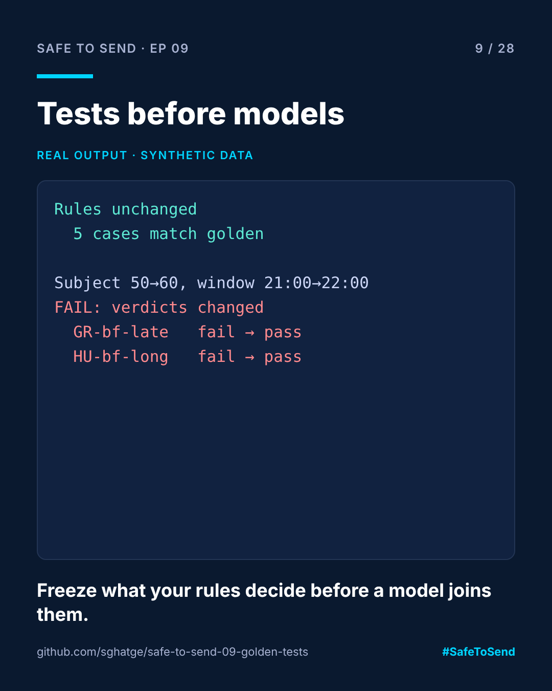

# safe-to-send-09 · Golden Tests Before Models



**Safe to Send · Episode 09** — a 28-day learn-in-public series on governing AI in CRM operations.

> Before adding a model to your rules, freeze what the rules decide today.

## The real-world scenario

You add an AI model to a rules-based QA workflow. A week later a market asks why their 21:30 send went out. Was it the model? A rule someone tweaked? A library upgrade? Without a record of what the system decided before, nobody can say.

## The use case

Golden tests record every verdict for a fixed set of cases and commit them. Any later change that moves a verdict fails the test and prints exactly which cases moved. Changing behaviour on purpose is fine, but it takes `update=True` and a commit someone reviews.

## Run it

```bash
python demo.py
python -m unittest discover -s tests -v
```

## Real example output

```
1. Rules unchanged
   qa_rules: 5 cases match golden

2. Someone 'just relaxes' the subject limit to 60 and the window to 22:00
   FAIL: verdicts changed
```

followed by a diff showing Greece's 21:30 send and Hungary's long subject flipping from `fail` to `pass`. Two "harmless" config edits changed two market outcomes, and the diff names both.

## Use it on your own rules

```python
from golden import check
ok, diff = check("my_rules", my_rule_function, my_cases)
```

Commit the `golden/` folder. Review it like code.

MIT · [Sangram Ghatge](https://www.linkedin.com/in/sangram-g-2369705b) · #SafeToSend
