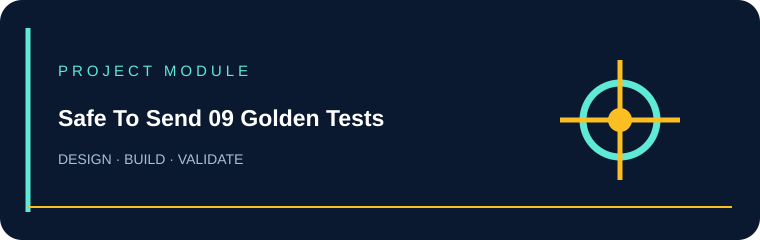
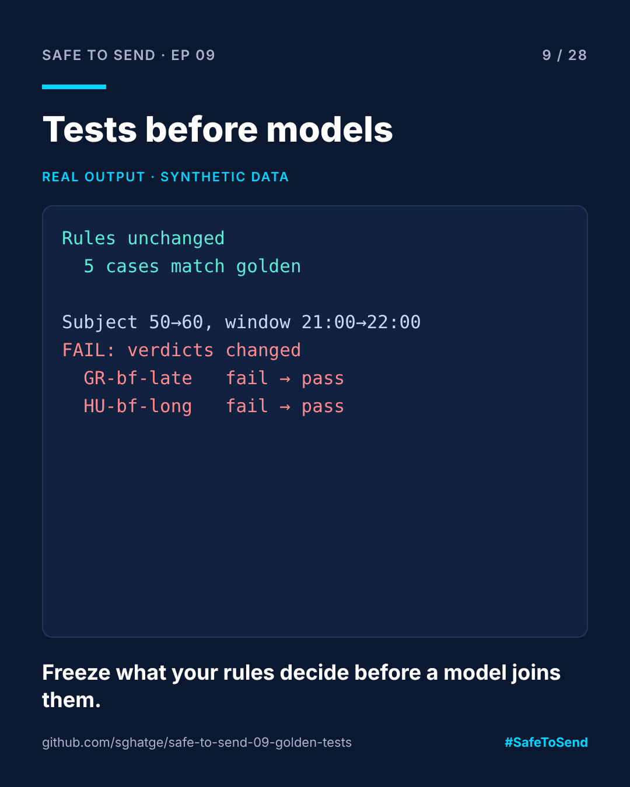

<div align="center">



**SAFE TO SEND · GOVERNED AI ENGINEERING SERIES · SAFE TO SEND 09 GOLDEN TESTS**

[GitHub Profile](https://github.com/sghatge) · [Portfolio](https://sghatge.github.io/adobe-campaign-v8-governance/)

</div>

---

# safe-to-send-09 · Golden Tests Before Models



**Safe to Send · Episode 09** — a 28-day learn-in-public series on governing AI in CRM operations.

> Before adding a model to your rules, freeze what the rules decide today.

## The real-world scenario

You add an AI model to a rules-based QA workflow. A week later a market asks why their 21:30 send went out. Was it the model? A rule someone tweaked? A library upgrade? Without a record of what the system decided before, nobody can say.

## The use case

Golden tests record every verdict for a fixed set of cases and commit them. Any later change that moves a verdict fails the test and prints exactly which cases moved. Changing behaviour on purpose is fine, but it takes `update=True` and a commit someone reviews.

## Run it

```bash
python demo.py
python -m unittest discover -s tests -v
```

## Real example output

```
1. Rules unchanged
   qa_rules: 5 cases match golden

2. Someone 'just relaxes' the subject limit to 60 and the window to 22:00
   FAIL: verdicts changed
```

followed by a diff showing Greece's 21:30 send and Hungary's long subject flipping from `fail` to `pass`. Two "harmless" config edits changed two market outcomes, and the diff names both.

## Use it on your own rules

```python
from golden import check
ok, diff = check("my_rules", my_rule_function, my_cases)
```

Commit the `golden/` folder. Review it like code.

MIT · [Sangram Ghatge](https://www.linkedin.com/in/sangram-g-2369705b) · #SafeToSend


---

## Portfolio integration & safe use

This repository is part of the **Safe to Send** 28-episode engineering series on governed AI for CRM and marketing operations.

- [Series index and episode map](https://github.com/sghatge/safe-to-send-21-series-map)
- [Complete portfolio](https://github.com/sghatge/sghatge)
- [OPSFORGE Build Lab](https://sghatge.streamlit.app/) — portfolio overview; this repository remains independently usable without the Build Lab.

**Safe-use boundary:** use the supplied examples and synthetic data for evaluation. Review the implementation, dependencies and tests before adapting it. Do not connect it to a production CRM, customer dataset or activation endpoint without a separate security, privacy and change-control review. No production integration or deployment is implied by this repository.
